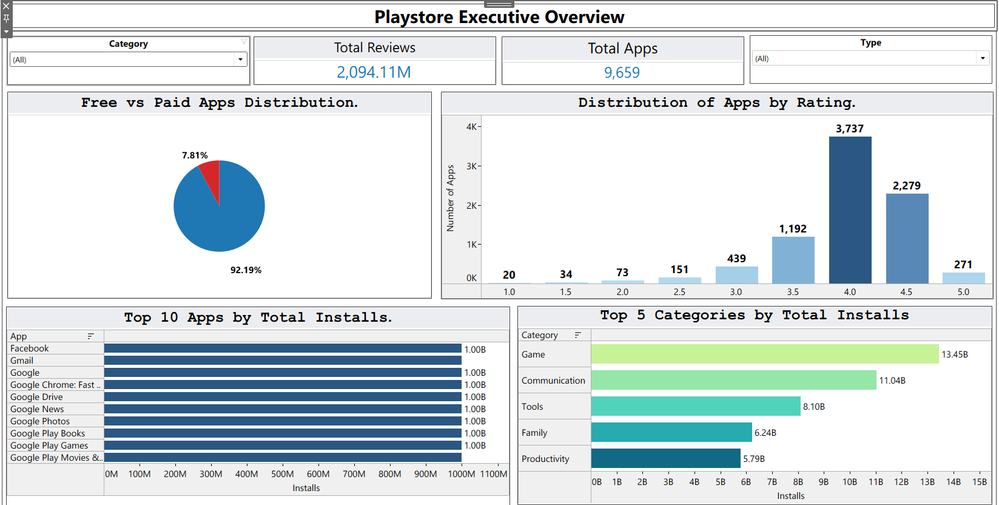
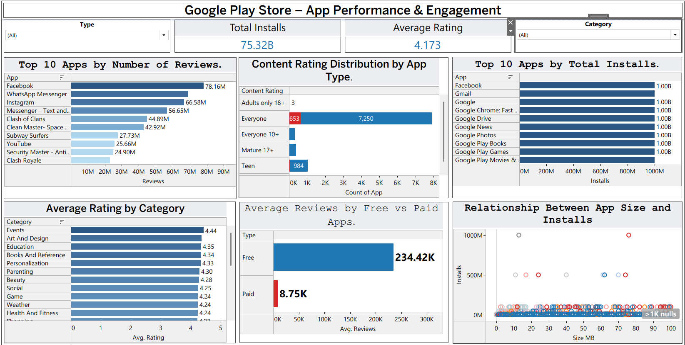

# Google Play Store App Analytics: Tableau Dashboard

**Tableau | Python (Jupyter Notebook) | Data Cleaning | App Market Analytics**

Prepared by **Shubham Shah**

---






> Every dashboard has interactive filters (Category, Type and an Updated Year slider) that update all charts on the page.

---

## 1. Project Overview

A mobile-app company has acquired a Google Play Store dataset and wants to know what makes an app successful. This project turns that raw data into a clean dataset and a three-page **Tableau** report that answers:

- What factors go with high ratings, installs and reviews?
- Which categories and genres are the most popular and the best rated?
- How do price, app size and content rating relate to user engagement?
- How often and when are apps updated?

### Stakeholders
App developers, product managers, the marketing team and senior management (internal); app users, advertisers and partner platforms (external).

The full case study, data dictionary and question list are in `Problem Statement.docx` (the "App Insights Unlocked" challenge).

---

## 2. Dataset

| Item | Detail |
|---|---|
| Source | Google Play Store Apps (Kaggle, `lava18/google-play-store-apps`, file `googleplaystore.csv`) |
| Raw file | `googleplaystore(Before_Cleaning).csv` |
| Clean file | `playstore_clean_data.csv` (used by the Tableau report) |
| Apps in the final report | 9,659 |

**Columns:** App, Category, Rating, Reviews, Size, Installs, Type, Price, Content Rating, Genres, Last Updated, Current Ver, Android Ver.

---

## 3. Data Cleaning (Jupyter Notebook)

The raw data was cleaned in **Python using a Jupyter Notebook**, `Playstore_Data_Cleaning.ipynb`, which reads `googleplaystore(Before_Cleaning).csv` and writes `playstore_clean_data.csv`. The Tableau report is built on the cleaned file only.

The cleaning follows the preprocessing steps in the problem statement:

| Step | What it covers |
|---|---|
| Missing values | Check and handle missing ratings, sizes, versions and other gaps |
| Data types | Convert `Installs`, `Price`, `Reviews` and `Size` from text to numbers |
| Duplicates | Remove repeated app entries |
| Text standardisation | Make `Category` and `Genres` consistent |
| Dates | Convert `Last Updated` to a proper date |

Open the notebook to see the exact code and the before / after row counts.

---

## 4. Requirements

**Functional**
- A clean, analysis-ready dataset.
- Headline KPIs: total apps, reviews, installs and average rating.
- Views of ratings, installs, reviews, categories, genres, price, size, content rating and updates.
- Interactive filters for exploration.

**Technical**
- Tableau Desktop (or Tableau Public) to open `Playstore_Report.twb`.
- Python 3 with Jupyter Notebook (pandas) to re-run the cleaning.
- `playstore_clean_data.csv` kept next to the workbook, or re-linked as the data source if Tableau asks for it.

---

## 5. Tools and Technologies

| Area | Used |
|---|---|
| Data cleaning | Python, Jupyter Notebook |
| Visualization | Tableau Desktop (workbook saved as `.twb`) |
| Tableau features | Calculated KPIs, filters and slicers, a year range slider, bar charts, pie chart, line chart, scatter plots, treemap, top-N views, dashboards |
| Source and docs | CSV files, Word problem statement, GitHub |

---

## 6. Dashboard Pages

| Dashboard | KPIs and filters | Visuals |
|---|---|---|
| **Playstore Executive Overview** | Total Reviews, Total Apps; filters: Category, Type | Free vs Paid distribution, distribution of apps by rating, top 10 apps by installs, top 5 categories by installs |
| **App Performance and Engagement** | Total Installs, Average Rating; filters: Type, Category | Top 10 apps by reviews, content rating by app type, top 10 apps by installs, average rating by category, average reviews for free vs paid, app size vs installs |
| **Pricing, Updates and Genre Analysis** | Average Rating, Total Reviews; filters: Updated Year (2010 to 2018), Type | App price vs rating, apps by content rating, monthly app updates trend, app size vs installs, app distribution by genre |

---

## 7. Approach

1. **Understand the problem:** read the case study and list the questions to answer.
2. **Clean the data** in the Jupyter Notebook and save `playstore_clean_data.csv`.
3. **Connect Tableau** to the clean file and build KPI sheets (apps, reviews, installs, average rating).
4. **Build the analysis sheets:** distributions, top-N rankings, category and genre views, price, size and update views.
5. **Assemble three dashboards** (Executive, Performance, Pricing / Updates / Genre) and add filters.
6. **Review** titles, labels and colours so each dashboard tells one clear story.

---

## 8. Challenges Faced

| Challenge | How it was handled |
|---|---|
| **Numbers stored as text** (Installs such as "1,000,000+", Price with a currency symbol, Size with units). | Converted to numeric columns in the notebook before loading into Tableau. |
| **Duplicate app entries** inflate counts. | Removed duplicates so each app is counted once (9,659 apps in the report). |
| **Missing values** in fields such as Rating, Size and Price. | Handled in the notebook; the Tableau charts show how many records are null (for example the scatter plots show their null counts). |
| **Highly skewed data:** a few apps have billions of installs or very high prices. | Used top-N views and checked outliers before drawing conclusions. |
| **Installs are ranges, not exact counts.** | Used the cleaned numeric value consistently and noted that totals are approximate. |
| **Too many genres for one chart.** | Used a treemap so the biggest genres stand out. |
| **Filters across sheets.** | Used Category, Type and Updated Year filters at dashboard level so every chart responds together. |

---

## 9. Key Insights

All figures below are read from the three dashboards.

- **Market size:** 9,659 apps, about 2,094 million reviews and 75.32 billion installs, with an average rating of **4.173**.
- **Free apps dominate:** 92.19% of apps are free and 7.81% are paid.
- **Ratings are generally high:** most apps sit in the 4.0 group (3,737 apps) and the 4.5 group (2,279 apps); very low ratings are rare (20 apps at 1.0 and 34 at 1.5), and only 271 apps reach 5.0.
- **Top categories by installs:** Game (13.45B), Communication (11.04B), Tools (8.10B), Family (6.24B) and Productivity (5.79B).
- **Top apps by installs:** the ten leaders (Facebook, Gmail, Google, Chrome, Drive, News, Photos, Play Books, Play Games, Play Movies) are all in the 1 billion installs band.
- **Top apps by reviews:** Facebook leads with 78.16M, then WhatsApp, Instagram (66.58M), Messenger (56.65M) and Clash of Clans (44.89M).
- **Free apps get far more feedback:** average reviews are 234.42K for free apps vs 8.75K for paid apps (about 27 times more).
- **Best rated categories:** Events (4.44) leads, followed by Art and Design, Education (4.35), Books and Reference (4.34) and Personalization (4.33).
- **Genres with the most apps:** Tools (829), Entertainment (592), Education (580), Business (420) and Medical (395).
- **Content rating:** "Everyone" is by far the most common (7,903 apps: 7,250 free and 653 paid), followed by Teen (984).
- **Updates peak in July:** 2,610 apps were last updated in July, compared with 305 in September and between about 470 and 640 in January to March.
- **Price:** almost all apps are priced low; a handful sit far out at roughly $300 to $400, and price shows no clear link to rating.
- **Size:** most apps are under 100 MB; installs cluster at low levels across all sizes, with a few high-install outliers, so size alone does not clearly explain installs.

> These are patterns in one snapshot of data, not proof of cause.

---

## 10. Recommendations

1. **Prioritise high-demand categories:** Game, Communication, Tools and Family bring the most installs; weigh this against competition in each.
2. **Learn from high-rated categories** such as Events, Art and Design, Education and Books and Reference when setting quality benchmarks.
3. **Use a free-first model:** free apps attract roughly 27 times more reviews, so start free (ads or in-app purchases) to build users and feedback, and price paid apps carefully.
4. **Plan the release calendar around updates:** updates are heavily concentrated in July, so plan releases and bug-fix cycles deliberately instead of following the crowd.
5. **Keep apps light:** most successful apps stay under 100 MB; use size as an optimisation target, not a growth lever.
6. **Aim for "Everyone"** content rating for the widest reach unless the product needs a narrower audience.
7. **Invest in reviews and ratings:** prompt satisfied users for reviews, since reviews and ratings go with visibility and trust.
8. **Improve the analysis next:** add review text for sentiment analysis, installs over time, revenue data and competitor tracking.

---

## 11. How to Use

1. Download the repository and keep all files in one folder.
2. Open `Playstore_Report.twb` in Tableau. If it cannot find the data, choose Edit Data Source and point it to `playstore_clean_data.csv`.
3. Use the Category, Type and Updated Year filters to explore each dashboard.
4. Open `Playstore_Data_Cleaning.ipynb` in Jupyter to see or re-run the cleaning.

---

## 12. Limitations

- One snapshot of the Play Store, so trends over time are limited to the update dates in the data.
- Installs are given as ranges (such as 1,000,000+), so totals are approximate.
- Rating and review counts are not tied to revenue; the data has no download dates or revenue.
- Extreme values (very high prices or installs) can distort averages, so read averages together with counts.

---

## 13. Repository Structure

```
google-play-store-app-analytics-tableau
|-- Playstore_App_Performance.png
|-- Playstore_Data_Cleaning.ipynb
|-- Playstore_Executive_Overview.png
|-- Playstore_Pricing & Analysis.png
|-- Playstore_Report.twb
|-- Problem Statement.docx
|-- googleplaystore(Before_Cleaning).csv
|-- playstore_clean_data.csv
`-- README.md
```

| File | Description |
|---|---|
| `Playstore_App_Performance.png` | Dashboard screenshot: App Performance and Engagement |
| `Playstore_Data_Cleaning.ipynb` | Jupyter Notebook that cleans the raw data |
| `Playstore_Executive_Overview.png` | Dashboard screenshot: Executive Overview |
| `Playstore_Pricing & Analysis.png` | Dashboard screenshot: Pricing, Updates and Genre Analysis |
| `Playstore_Report.twb` | Tableau workbook with the three dashboards |
| `Problem Statement.docx` | Case study, data dictionary and questions |
| `googleplaystore(Before_Cleaning).csv` | Raw dataset before cleaning |
| `playstore_clean_data.csv` | Cleaned dataset used in Tableau |
| `README.md` | Project documentation (this file) |

---

## Author

**Shubham Shah**
Tableau | Python | Data Analytics Portfolio Project
